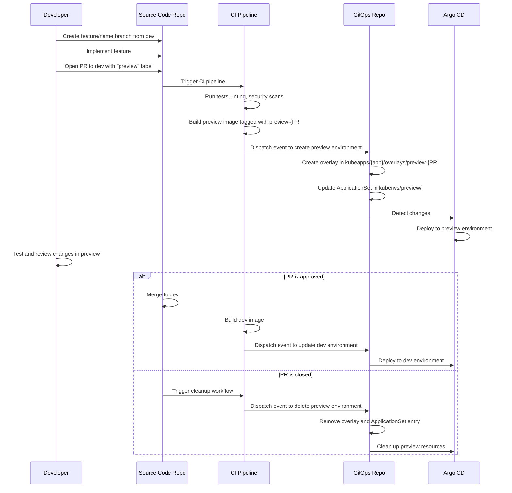
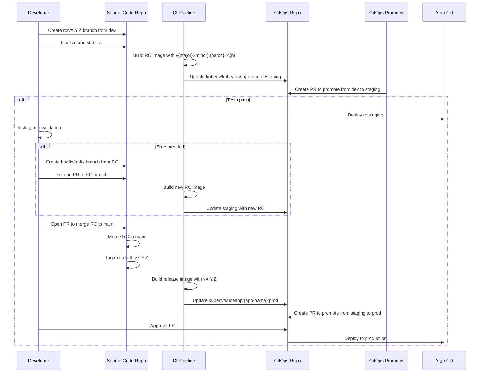
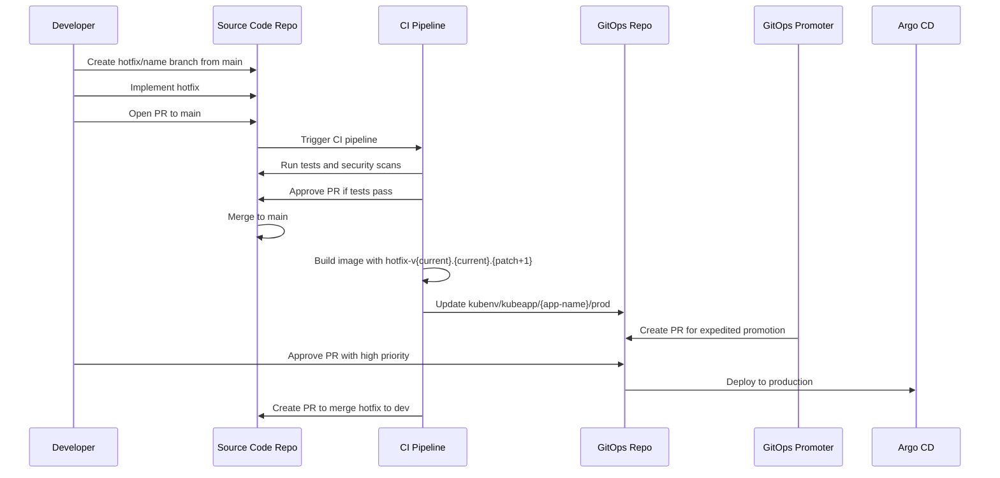

# Updated Branching and Release Strategy with GitOps Integration

## 1. Overview

This document outlines our branching and release strategy, integrating our source code repositories (KubeApp) with our GitOps workflow (KubeProject) using Argo CD, Argo Rollouts, and GitOps Promoter. The strategy is designed to enable streamlined development, efficient testing, and reliable deployments across all environments.

## 2. Repository Organization

Our architecture consists of two main repository types:

1. **Source Code Repositories (KubeApp)**:
   - Contains application code, tests, and CI configuration
   - Each microservice has its own repository
   - Follows a standardized structure from templates
   - CI pipeline manages building, testing, and image creation

2. **GitOps Repository (KubeProject)**:
   - Contains Kubernetes manifests for all environments
   - Structured with Kustomize bases and overlays
   - Uses environment namespaces within branches for deployments
   - Managed primarily through automated processes triggered by source repository events

## 3. Branch Structure

### 3.1 Source Code Repository Branches

| Branch Type | Naming Pattern | Created From | Purpose |
|-------------|----------------|--------------|---------|
| Main | `main` | N/A | Stable code that has passed all tests, production-ready |
| Development | `dev` | `main` | Integration branch for ongoing development |
| Feature | `feature/*` | `dev` | New features or enhancements |
| Bugfix | `bugfix/*` or `bug/*` | `dev` | Non-critical bug fixes |
| Breaking | `breaking/*` | `dev` | Changes that break backward compatibility |
| Maintenance | `maintenance/*` | `dev` | Maintenance tasks, not linked to features or bugs |
| Chore | `chore/*` | `dev` | Housekeeping tasks, dependency updates, etc. |
| Hotfix | `hotfix/*` | `main` | Critical fixes for production issues |
| Release Candidate | `rc/v{major}.{minor}.{patch}` | `dev` | Stabilization branch for releases |

### 3.2 GitOps Repository Structure

Instead of using branch-per-environment, our GitOps repository uses a structured path approach to organize environments:

```
/
├── kubeapps/                        # Application manifests
│   ├── app-name/                    # Specific application
│   │   ├── base/                    # Base configuration
│   │   │   ├── conf.yaml
│   │   │   ├── deployment.yaml
│   │   │   ├── rollout.yaml
│   │   │   ├── ingress.yaml
│   │   │   ├── service.yaml
│   │   │   └── kustomization.yaml
│   │   └── overlays/                # Environment-specific overlays
│   │       ├── dev/                 # Development environment
│   │       ├── staging/            # Staging environment
│   │       ├── prod/                # Production environment
│   │       └── preview-{PR#}/       # Preview environments
├── kubenvs/                         # Environment configurations
│   ├── dev/                         # Development environment
│   ├── staging/                    # Staging environment
│   ├── prod/                        # Production environment
│   └── preview/                     # Preview environment configurations
│       └── pr-generator.yaml        # ApplicationSet for previews
```

The GitOps Promoter uses the following branches for promotion:

| Branch | Purpose |
|--------|---------|
| `kubenv/kubeapp/{app-name}/dev` | Development environment for application |
| `kubenv/kubeapp/{app-name}/staging` | Staging environment for application |
| `kubenv/kubeapp/{app-name}/prod` | Production environment for application |

## 4. Workflow for Different Change Types

### 4.1 Feature Development with Preview Environments



1. Developer creates a `feature/name` branch from `dev`
2. Completes work with required tests
3. Opens a PR to merge into `dev` with the "preview" label
4. CI builds a preview image tagged with `preview-{PR#}-{SHA}`
5. CI dispatches an event to the GitOps repository to create a preview environment
6. GitOps repository creates the overlay and updates the ApplicationSet
7. Argo CD deploys the preview environment
8. When the PR is merged, CI builds a new image for the dev environment
9. If the PR is closed without merging, the preview environment is automatically cleaned up

### 4.2 Release Candidate Creation and Promotion



1. Create `rc/vX.Y.Z` branch from `dev` when ready to release
2. CI builds image with tag `v{major}.{minor}.{patch}-rc1`
3. CI updates the GitOps repository's staging branch
4. GitOps Promoter creates a PR to promote from dev to staging
5. After tests pass, deploy to staging environment
6. If bugs are found, fixes are applied to RC branch and new RC images built
7. When stable, RC branch is merged to `main` and tagged with version
8. CI builds final release image with `v{major}.{minor}.{patch}`
9. CI updates the GitOps repository's production branch
10. GitOps Promoter creates PR to promote from staging to prod
11. After approval, changes are deployed to production

### 4.3 Hotfix Process



1. Developer creates a `hotfix/description` branch from `main`
2. Fix is implemented and tested
3. PR is opened to merge into `main`
4. After expedited review and tests, the PR is merged
5. CI builds hotfix image tagged with `v{current}.{current}.{patch+1}`
6. CI updates the GitOps repository's production branch
7. GitOps Promoter creates an expedited PR for promotion
8. After expedited approval, deploy to production
9. CI also opens a PR to merge the hotfix back to `dev`

## 5. GitOps Promoter Configuration

The GitOps Promoter is configured to manage the promotion process between environments, ensuring that each promotion requires the appropriate checks and approvals.

```yaml
apiVersion: promoter.argoproj.io/v1alpha1
kind: PromotionStrategy
metadata:
  name: app-promotion-strategy
spec:
  gitRepositoryRef:
    name: kubeproject-template
  
  # Always verify application health before promotion
  activeCommitStatuses:
    - key: argocd-app-health
  
  environments:
    # Dev environment
    - branch: kubenv/kubeapp/{app-name}/dev
      autoMerge: true
      reviewerCount: 0
      activeCommitStatuses:
        - key: basic-tests
        - key: security-scan
        - key: api-validation
      syncWindow:
        schedule: "* 9-17 * * 1-5"
        duration: 8h
        timeZone: "UTC"
    
    # Staging environment
    - branch: kubenv/kubeapp/{app-name}/staging
      autoMerge: true
      reviewerCount: 1
      activeCommitStatuses:
        - key: functional-tests
        - key: integration-tests
        - key: security-scan
      proposedCommitStatuses:
        - key: load-tests
      syncWindow:
        schedule: "* 9-17 * * 1-5"
        duration: 8h
        timeZone: "UTC"
    
    # Production environment
    - branch: kubenv/kubeapp/{app-name}/prod
      autoMerge: false
      reviewerCount: 2
      approverGroups:
        - release-managers
      activeCommitStatuses:
        - key: stress-tests
        - key: security-scan
        - key: compliance-check
      proposedCommitStatuses:
        - key: chaos-tests
      syncWindow:
        schedule: "* 10-15 * * 2,4"
        duration: 5h
        timeZone: "UTC"
```

## 6. CI/CD Pipeline Integration

### 6.1 Image Tagging Strategy

| Branch Type | Image Tag Format | Example |
|-------------|------------------|---------|
| Feature (Preview) | `preview-{PR#}-{SHA}` | `preview-123-abc123` |
| Development | `dev-{timestamp}-{short_sha}` | `dev-20240506-ghi789` |
| Release Candidate | `v{major}.{minor}.{patch}-rc{n}` | `v1.2.0-rc1` |
| Hotfix | `v{major}.{minor}.{patch}-hotfix-{short_sha}` | `v1.2.1-hotfix-jkl012` |
| Release | `v{major}.{minor}.{patch}` | `v1.2.0` |

### 6.2 Version Bump Strategy

Our system automatically determines the appropriate version bump based on the branch prefix:

| Branch Prefix | Version Bump | Example |
|---------------|--------------|---------|
| `feature/*` | Minor | `1.0.0` → `1.1.0` |
| `breaking/*` | Major | `1.0.0` → `2.0.0` |
| `bug/*` or `bugfix/*` | Patch | `1.0.0` → `1.0.1` |
| `maintenance/*` | Patch | `1.0.0` → `1.0.1` |
| `chore/*` | None | No version change |
| `hotfix/*` | Patch | `1.0.0` → `1.0.1` |

### 6.3 CI Pipeline Responsibilities

1. **Build and Test**:
   - Compile code and run unit tests
   - Run linting and code quality checks
   - Perform security scanning with Trivy
   - Update version information

2. **Image Management**:
   - Build multi-architecture container images (AMD64/ARM64)
   - Tag according to branch type and context
   - Push to container registry
   - Create multi-architecture manifest

3. **GitOps Integration**:
   - Dispatch events to GitOps repository for environment updates
   - Create preview environments for PRs with the "preview" label
   - Clean up preview environments when PRs are closed

### 6.4 Argo CD ApplicationSet Configuration

For regular environments:

```yaml
apiVersion: argoproj.io/v1alpha1
kind: ApplicationSet
metadata:
  name: microservices
  namespace: argocd
spec:
  generators:
    - matrix:
        generators:
          - git:
              repoURL: https://github.com/organization/gitops-repo.git
              revision: HEAD
              directories:
                - path: kubeapps/*/base
          - list:
              elements:
                - env: dev
                  namespace: dev
                - env: staging
                  namespace: staging
                - env: prod
                  namespace: prod
  template:
    metadata:
      name: '{{path.basename}}-{{env}}'
    spec:
      project: default
      source:
        repoURL: https://github.com/organization/gitops-repo.git
        targetRevision: HEAD
        path: 'kubeapps/{{path.basename}}/overlays/{{env}}'
      destination:
        server: https://kubernetes.default.svc
        namespace: '{{namespace}}'
      syncPolicy:
        automated:
          prune: true
          selfHeal: true
```

For preview environments:

```yaml
apiVersion: argoproj.io/v1alpha1
kind: ApplicationSet
metadata:
  name: preview-appset
  namespace: argocd
spec:
  generators:
  - list:
      elements: []
  template:
    metadata:
      name: '{{appsetName}}'
    spec:
      destination:
        namespace: kubeapps
        server: https://kubernetes.default.svc
      project: default
      source:
        path: kubeapps/{{appName}}/overlays/preview-{{prNumber}}
        repoURL: https://github.com/organization/gitops-repo.git
        targetRevision: HEAD
      syncPolicy:
        automated:
          prune: true
          selfHeal: true
        syncOptions:
        - CreateNamespace=true
```

## 7. Testing Strategy

### 7.1 Test Types by Environment

| Environment | Test Types | Description |
|-------------|------------|-------------|
| Preview | Basic Tests | Unit tests, linting, basic API validation |
|  | Security Scan | Container image scanning with Trivy |
| Dev | Basic Tests | Unit tests, linting, security scanning |
|  | API Tests | Basic API validation |
|  | Acceptance Tests | Validates user stories |
| Staging | Functional Tests | Full functionality testing |
|  | Integration Tests | Service interactions testing |
|  | Load Tests | Performance under normal load |
|  | Contract Tests | API contract validation |
| Production | Stress Tests | Performance under heavy load |
|  | Security Tests | In-depth security validation |
|  | Compliance Tests | Regulatory compliance checks |
|  | Chaos Tests | System resilience testing |

## 8. Common Workflow Examples

### 8.1 Feature Development with Preview

```
1. Create feature/new-api branch from dev
2. Implement feature, add tests
3. Open PR to dev with preview label
4. CI builds preview-123-abc123 image
5. CI dispatches event to create preview environment
6. Preview environment is deployed and available for testing
7. After reviews, merge to dev
8. Preview environment is automatically cleaned up
9. CI builds dev image for the dev environment
```

### 8.2 Release Candidate Creation

```
1. Create rc/v1.2.0 branch from dev
2. CI builds v1.2.0-rc1 image
3. CI updates GitOps repository for staging
4. GitOps Promoter creates PR for promotion
5. Tests run in staging environment
6. If issues found:
   a. Create bugfix/rc-fix branch from RC
   b. Fix and merge to RC
   c. CI builds v1.2.0-rc2 image
   d. Repeat testing
7. When stable, merge RC to main with v1.2.0 tag
8. CI builds v1.2.0 image for production
9. GitOps Promoter creates PR for production promotion
10. After approval, deploy to production
```

### 8.3 Hotfix Process

```
1. Create hotfix/critical-fix branch from main
2. Implement fix with tests
3. Open PR to main with high priority
4. After expedited review, merge to main
5. CI builds v1.2.1-hotfix-abc123 image
6. CI updates GitOps repository for production
7. GitOps Promoter creates expedited PR
8. After approval, deploy to production
9. CI creates PR to merge hotfix back to dev
```

## 9. Rollback Strategy

### 9.1 Environment Rollback

For development and staging environments, rollbacks can be automated through the GitOps repository by reverting the appropriate commit and letting Argo CD sync the previous state.

For production, rollbacks follow a more controlled process:

1. Identify the stable version to roll back to
2. Create a rollback PR in the GitOps repository
3. After approval, Argo Rollouts handles the progressive rollback
4. Monitor the rollback closely for any issues

### 9.2 Progressive Rollbacks with Argo Rollouts

Argo Rollouts provides sophisticated rollback capabilities:

```yaml
apiVersion: argoproj.io/v1alpha1
kind: Rollout
metadata:
  name: example-rollout
spec:
  replicas: 5
  strategy:
    canary:
      steps:
        - setWeight: 20
        - pause: {duration: 10m}
        - setWeight: 40
        - pause: {duration: 10m}
        - setWeight: 60
        - pause: {duration: 10m}
        - setWeight: 80
        - pause: {duration: 10m}
  revisionHistoryLimit: 3  # Store this many old ReplicaSets for rollbacks
```

This configuration enables rollbacks to any of the last 3 versions with the same progressive deployment strategy.

## 10. Special Considerations

### 10.1 Multi-Architecture Images

Our CI pipeline builds images for both AMD64 and ARM64 architectures, creating a multi-architecture manifest to support deployments across diverse infrastructure.

### 10.2 Security Scanning Integration

Trivy security scanning is integrated into our CI pipeline, scanning container images for vulnerabilities at multiple stages:

1. During PR creation (results as PR comment)
2. Before promotion to production (blocking if critical vulnerabilities found)

### 10.3 Branch Prefix Automation

The CI system automatically applies labels to PRs based on branch prefixes, which helps with:
- Categorizing changes
- Determining version bumps
- Setting appropriate review requirements

## 11. Conclusion

This branching and release strategy provides a structured approach to managing code changes across environments while leveraging GitOps principles for consistency and reliability. By clearly defining the flow from development to production with appropriate testing gates, we can maintain high quality while enabling rapid delivery of features and critical fixes.

The integration of preview environments provides quick feedback on changes, while the multi-stage promotion process ensures that only properly tested code reaches production.
