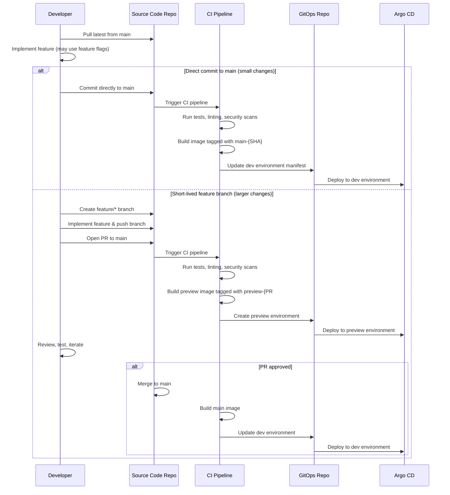
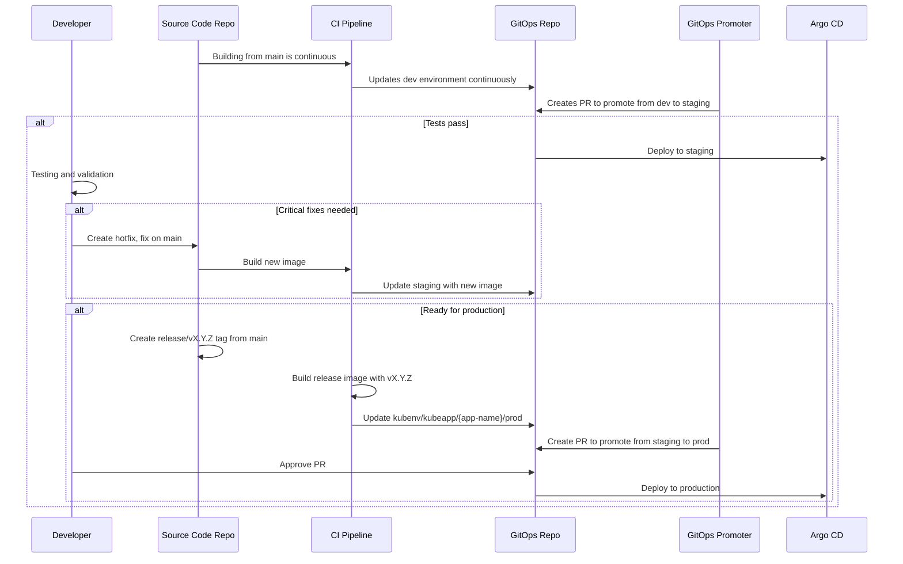
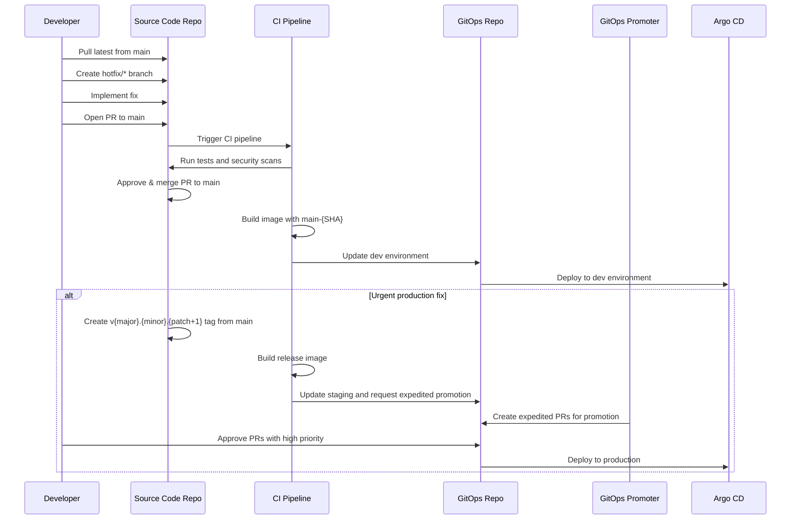

# Updated Branching and Release Strategy with Trunk-Based Development and GitOps Integration

## 1. Overview

This document outlines our trunk-based development and release strategy, integrating our source code repositories (KubeApp) with our GitOps workflow (KubeProject) using Argo CD, Argo Rollouts, and GitOps Promoter. The strategy is designed to enable streamlined development, efficient testing, and reliable deployments across all environments while fostering high-throughput collaboration and continuous integration.

## 2. Repository Organization

Our architecture consists of two main repository types:

1. **Source Code Repositories (KubeApp)**:
   - Contains application code, tests, and CI configuration
   - Each microservice has its own repository
   - Follows a standardized structure from templates
   - CI pipeline manages building, testing, and image creation

2. **GitOps Repository (KubeProject)**:
   - Contains Kubernetes manifests for all environments
   - Structured with Kustomize bases and overlays
   - Uses environment namespaces for deployments
   - Managed primarily through automated processes triggered by source repository events

## 3. Branch Structure

### 3.1 Source Code Repository Branches

| Branch Type | Naming Pattern | Created From | Purpose |
|-------------|----------------|--------------|---------|
| Trunk | `main` | N/A | Single shared branch where all development happens |
| Short-lived Feature | `feature/*` | `main` | Short-lived branches (1-2 days max) for code review |
| Hotfix | `hotfix/*` | `main` | Critical fixes for production issues (merged directly to main after review) |
| Release | `release/v{major}.{minor}.{patch}` | `main` | Created just-in-time for release, not for development |

### 3.2 GitOps Repository Structure

Our GitOps repository uses a structured path approach to organize environments:

```
/
├── kubeapps/                        # Application manifests
│   ├── app-name/                    # Specific application
│   │   ├── base/                    # Base configuration
│   │   │   ├── conf.yaml
│   │   │   ├── deployment.yaml
│   │   │   ├── rollout.yaml
│   │   │   ├── ingress.yaml
│   │   │   ├── service.yaml
│   │   │   └── kustomization.yaml
│   │   └── overlays/                # Environment-specific overlays
│   │       ├── dev/                 # Development environment
│   │       ├── staging/            # Staging environment
│   │       ├── prod/                # Production environment
│   │       └── preview-{PR#}/       # Preview environments
├── kubenvs/                         # Environment configurations
│   ├── dev/                         # Development environment
│   ├── staging/                    # Staging environment
│   ├── prod/                        # Production environment
│   └── preview/                     # Preview environment configurations
│       └── pr-generator.yaml        # ApplicationSet for previews
```

The GitOps Promoter uses the following branches for promotion:

| Branch | Purpose |
|--------|---------|
| `kubenv/kubeapp/{app-name}/dev` | Development environment for application |
| `kubenv/kubeapp/{app-name}/staging` | Staging environment for application |
| `kubenv/kubeapp/{app-name}/prod` | Production environment for application |

## 4. Workflow for Different Change Types

### 4.1 Feature Development with Trunk-Based Development



1. Developers always pull latest from the main trunk branch
2. For small changes, developers may commit directly to main following team standards
3. For larger changes requiring review, developers create a short-lived feature branch
4. Feature branches typically last 1-2 days maximum
5. PR review process is continuous and prioritized by the team
6. Feature flags are used for incomplete features that need to be merged to main
7. Branch by Abstraction is used for larger structural changes

### 4.2 Production Release Process



1. Main branch is continuously deployed to the dev environment
2. When ready for promotion, GitOps Promoter creates a PR to promote from dev to staging
3. After testing in staging, a release tag is created from main
4. Release tags follow semantic versioning (vX.Y.Z)
5. CI builds the release image which is deployed to staging final verification
6. GitOps Promoter creates a PR to promote from staging to production
7. After approval, changes are deployed to production using Argo Rollouts for progressive delivery

### 4.3 Hotfix Process



1. Hotfixes are always implemented on a branch created from main
2. After quick review, the hotfix is merged back to main
3. If the fix is needed in production urgently:
   - A new release tag is created from main
   - CI builds a hotfix release image
   - GitOps Promoter creates expedited promotion PRs
   - After expedited approval, the fix is deployed to production

## 5. Feature Flags and Branch by Abstraction

### 5.1 Feature Flags

Feature flags are used to merge incomplete features to the main branch without affecting production functionality:

```yaml
apiVersion: v1
kind: ConfigMap
metadata:
  name: feature-flags
data:
  FEATURE_NEW_UI: "false"  # Set to true when ready
  FEATURE_PAYMENT_GATEWAY_V2: "false"
  FEATURE_ANALYTICS_ENGINE: "false"
```

Our feature flag implementation follows these principles:
- Feature flags are defined in code and in configuration
- All incomplete features are hidden behind feature flags
- Feature flags allow for A/B testing and controlled rollouts
- Feature flags are cleaned up after features are fully rolled out

### 5.2 Branch by Abstraction

For larger architectural changes, we use the Branch by Abstraction technique:

1. Create an abstraction layer around the code to be changed
2. Develop the new implementation behind this abstraction
3. Gradually switch components to use the new implementation
4. Once complete, remove the old implementation
5. Finally, remove the abstraction layer

This allows for large-scale changes to be made incrementally while the codebase remains releasable at all times.

## 6. GitOps Promoter Configuration

The GitOps Promoter is configured to manage the promotion process between environments, ensuring that each promotion requires the appropriate checks and approvals.

```yaml
apiVersion: promoter.argoproj.io/v1alpha1
kind: PromotionStrategy
metadata:
  name: app-promotion-strategy
spec:
  gitRepositoryRef:
    name: kubeproject-template
  
  # Always verify application health before promotion
  activeCommitStatuses:
    - key: argocd-app-health
  
  environments:
    # Dev environment
    - branch: kubenv/kubeapp/{app-name}/dev
      autoMerge: true
      reviewerCount: 0
      activeCommitStatuses:
        - key: basic-tests
        - key: security-scan
        - key: api-validation
      syncWindow:
        schedule: "* 9-17 * * 1-5"
        duration: 8h
        timeZone: "UTC"
    
    # Staging environment
    - branch: kubenv/kubeapp/{app-name}/staging
      autoMerge: true
      reviewerCount: 1
      activeCommitStatuses:
        - key: functional-tests
        - key: integration-tests
        - key: security-scan
      proposedCommitStatuses:
        - key: load-tests
      syncWindow:
        schedule: "* 9-17 * * 1-5"
        duration: 8h
        timeZone: "UTC"
    
    # Production environment
    - branch: kubenv/kubeapp/{app-name}/prod
      autoMerge: false
      reviewerCount: 2
      approverGroups:
        - release-managers
      activeCommitStatuses:
        - key: stress-tests
        - key: security-scan
        - key: compliance-check
      proposedCommitStatuses:
        - key: chaos-tests
      syncWindow:
        schedule: "* 10-15 * * 2,4"
        duration: 5h
        timeZone: "UTC"
```

## 7. CI/CD Pipeline Integration

### 7.1 Image Tagging Strategy

| Branch Type | Image Tag Format | Example |
|-------------|------------------|---------|
| Main branch | `main-{timestamp}-{short_sha}` | `main-20240506-abc123` |
| Feature branch (PR) | `preview-{PR#}-{SHA}` | `preview-123-def456` |
| Release | `v{major}.{minor}.{patch}` | `v1.2.0` |

### 7.2 Version Bump Strategy

Our system automatically determines the appropriate version bump based on conventional commit messages:

| Commit Prefix | Version Bump | Example |
|---------------|--------------|---------|
| `feat:` | Minor | `1.0.0` → `1.1.0` |
| `feat!:` or `BREAKING CHANGE:` | Major | `1.0.0` → `2.0.0` |
| `fix:` | Patch | `1.0.0` → `1.0.1` |
| `chore:`, `docs:`, `refactor:`, etc. | None | No version change |

### 7.3 CI Pipeline Responsibilities

1. **Continuous Integration on Main**:
   - Build and test every commit to main
   - Run security scanning with Trivy
   - Generate versioned artifacts
   - Update dev environment automatically

2. **Pull Request Validation**:
   - Build and test every PR
   - Perform speculative merge tests
   - Create preview environments
   - Report status back to PR

3. **Release Pipeline**:
   - Build multi-architecture container images (AMD64/ARM64)
   - Tag according to semantic version
   - Push to container registry
   - Create multi-architecture manifest
   - Trigger environment promotion workflow

### 7.4 Argo CD ApplicationSet Configuration

For regular environments:

```yaml
apiVersion: argoproj.io/v1alpha1
kind: ApplicationSet
metadata:
  name: microservices
  namespace: argocd
spec:
  generators:
    - matrix:
        generators:
          - git:
              repoURL: https://github.com/organization/gitops-repo.git
              revision: HEAD
              directories:
                - path: kubeapps/*/base
          - list:
              elements:
                - env: dev
                  namespace: dev
                - env: staging
                  namespace: staging
                - env: prod
                  namespace: prod
  template:
    metadata:
      name: '{{path.basename}}-{{env}}'
    spec:
      project: default
      source:
        repoURL: https://github.com/organization/gitops-repo.git
        targetRevision: HEAD
        path: 'kubeapps/{{path.basename}}/overlays/{{env}}'
      destination:
        server: https://kubernetes.default.svc
        namespace: '{{namespace}}'
      syncPolicy:
        automated:
          prune: true
          selfHeal: true
```

For preview environments:

```yaml
apiVersion: argoproj.io/v1alpha1
kind: ApplicationSet
metadata:
  name: preview-appset
  namespace: argocd
spec:
  generators:
  - list:
      elements: []
  template:
    metadata:
      name: '{{appsetName}}'
    spec:
      destination:
        namespace: preview-{{prNumber}}
        server: https://kubernetes.default.svc
      project: default
      source:
        path: kubeapps/{{appName}}/overlays/preview-{{prNumber}}
        repoURL: https://github.com/organization/gitops-repo.git
        targetRevision: HEAD
      syncPolicy:
        automated:
          prune: true
          selfHeal: true
        syncOptions:
        - CreateNamespace=true
```

## 8. Testing Strategy

### 8.1 Test Types by Environment

| Environment | Test Types | Description |
|-------------|------------|-------------|
| Main (CI) | Unit Tests | Fast tests that verify code components |
|  | Linting | Code quality and standards |
|  | Security Scan | Basic security scanning |
| Preview | Basic Tests | Unit tests, linting, basic API validation |
|  | Security Scan | Container image scanning with Trivy |
| Dev | Basic Tests | Unit tests, linting, security scanning |
|  | API Tests | Basic API validation |
|  | Acceptance Tests | Validates user stories |
| Staging | Functional Tests | Full functionality testing |
|  | Integration Tests | Service interactions testing |
|  | Load Tests | Performance under normal load |
|  | Contract Tests | API contract validation |
| Production | Stress Tests | Performance under heavy load |
|  | Security Tests | In-depth security validation |
|  | Compliance Tests | Regulatory compliance checks |
|  | Chaos Tests | System resilience testing |

## 9. Common Workflow Examples

### 9.1 Small Feature Development

```
1. Pull latest from main
2. Implement small feature directly on main
3. Commit with appropriate conventional commit prefix
4. CI builds and deploys to dev environment
5. Feature is automatically included in the next promotion cycle
```

### 9.2 Larger Feature Development with Review

```
1. Pull latest from main
2. Create feature/new-api branch
3. Implement feature, add tests
4. Open PR to main
5. CI builds preview image and creates preview environment
6. Reviewers provide feedback
7. Developer addresses feedback
8. PR is approved and merged to main
9. CI builds main image and deploys to dev environment
10. Feature branch is automatically deleted
```

### 9.3 Feature Behind Feature Flag

```
1. Pull latest from main
2. Implement feature behind feature flag
3. Commit directly to main or via PR
4. CI builds and deploys to dev environment
5. Feature flag is turned on in dev for testing
6. Feature is promoted to staging with flag off
7. After validation, flag is turned on in staging
8. Feature is promoted to production with flag off
9. Flag is gradually enabled in production for specific users/regions
10. Once fully rolled out, flag and old code are removed
```

### 9.4 Release Process

```
1. Main branch is continuously deployed to dev
2. GitOps Promoter creates PR from dev to staging
3. Staging validation happens with all tests passing
4. Release tag v1.2.0 is created from main
5. Release image is built and verified
6. GitOps Promoter creates PR from staging to prod
7. After approval, changes are progressively rolled out to production
```

### 9.5 Hotfix Process

```
1. Pull latest from main
2. Create hotfix/critical-fix branch
3. Implement fix with tests
4. Open PR to main with high priority
5. After expedited review, merge to main
6. CI builds main image for the dev environment
7. Create v1.2.1 tag from main
8. CI builds release image
9. Expedited promotion through environments
```

## 10. Rollback Strategy

### 10.1 Environment Rollback

For any environment, rollbacks can be automated through the GitOps repository:

1. Revert the commit in the GitOps repository that updated the image tag
2. Argo CD detects the change and reverts to the previous version
3. For production rollbacks, use Argo Rollouts to perform a progressive rollback

### 10.2 Progressive Rollbacks with Argo Rollouts

Argo Rollouts provides sophisticated rollback capabilities:

```yaml
apiVersion: argoproj.io/v1alpha1
kind: Rollout
metadata:
  name: example-rollout
spec:
  replicas: 5
  strategy:
    canary:
      steps:
        - setWeight: 20
        - pause: {duration: 10m}
        - setWeight: 40
        - pause: {duration: 10m}
        - setWeight: 60
        - pause: {duration: 10m}
        - setWeight: 80
        - pause: {duration: 10m}
  revisionHistoryLimit: 3  # Store this many old ReplicaSets for rollbacks
```

This configuration enables rollbacks to any of the last 3 versions with the same progressive deployment strategy.

## 11. Special Considerations

### 11.1 Developer Workflow and Discipline

With Trunk-Based Development, developers must:

1. Pull from main frequently (multiple times per day)
2. Run the full local build (compile, unit tests, integration tests) before committing
3. Use feature flags for incomplete features
4. Prioritize code reviews for team members
5. Keep short-lived feature branches under 1-2 days
6. Separate refactoring commits from functional commits

### 11.2 Continuous Code Review

Code review is a continuous process:

1. Reviews should be completed within hours, not days
2. Critical PRs get priority in the review queue
3. Team members allocate dedicated time for reviews
4. Automated checks run before human review
5. Review comments focus on quality, not style (use linters for style)

### 11.3 Multi-Architecture Images

Our CI pipeline builds images for both AMD64 and ARM64 architectures, creating a multi-architecture manifest to support deployments across diverse infrastructure.

### 11.4 Security Scanning Integration

Trivy security scanning is integrated into our CI pipeline, scanning container images for vulnerabilities at multiple stages:

1. During PR creation (results as PR comment)
2. Before promotion to production (blocking if critical vulnerabilities found)

## 12. Conclusion

This Trunk-Based Development branching and release strategy provides a structured approach to managing code changes across environments while leveraging GitOps principles for consistency and reliability. By focusing on a single trunk branch with short-lived feature branches for review, we enable:

1. Faster integration of changes
2. Continuous testing and deployment
3. Reduced merge conflicts and integration problems
4. Better collaboration between team members
5. More frequent and reliable releases

The integration with our GitOps workflow using Argo CD and Argo Rollouts ensures reliable, progressive deployments while maintaining the high quality and stability our users expect.